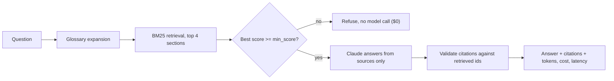

# grounded-knowledge-rag

A small, domain-agnostic **knowledge RAG** in Python with Claude. It answers questions from a folder of Markdown documents, **cites the exact section** behind every statement, **refuses** when the answer is not in the documents, and **measures** retrieval quality, answer grounding, cost, and latency.

The demo corpus is the policy handbook of **Puerto Azul Travel, a fictional travel agency**: cancellations, payments, refunds, groups, commissions, invoicing, and escalations. Swap the folder to use it for any other domain.

Retrieval for a real question, run offline with no API key:

```text
$ akr search "A client cancels their package 20 days before departure. How much do we charge?"
 13.43  cancellations#vacation-packages
  7.83  changes#date-changes
  6.90  payments#installment-plans
  6.08  payments#late-payments
```

`akr ask` sends those 4 sections to Claude, which answers with a citation like `[cancellations#vacation-packages]` in every factual sentence, and reports tokens, cost, and latency.

## Why it is built this way

- **Grounded answers or none.** The model may only use the retrieved sources, must cite one in every factual sentence, and must reply with a fixed refusal when the sources do not contain the answer.
- **Citations are verified, not trusted.** Every cited id is checked against the sections that were actually retrieved. A citation to anything else is flagged as invalid.
- **A $0 refusal path.** When retrieval is weak, the question is refused before any model call, so off-topic questions cost nothing.
- **Measured, not assumed.** Retrieval is evaluated offline for free. Answers are evaluated with deterministic checks. Every answer reports tokens, USD, and seconds.
- **Small and inspectable.** BM25 is implemented from scratch in about 60 lines. The only runtime dependency is the Anthropic SDK.

## How it works



1. **Ingest:** each `##` section of each Markdown file becomes a chunk with a citable id, `<file>#<section-slug>`, for example `payments#deposit`.
2. **Expand:** an optional per-corpus `glossary.toml` maps everyday words to document vocabulary ("suitcase" to "baggage", "money back" to "refund"), because keyword search only matches exact terms.
3. **Retrieve:** BM25 ranks the sections. Headings are weighted higher than body text.
4. **Gate:** if the best score is below `min_score`, the system refuses for free.
5. **Answer:** Claude (Haiku by default) gets the top sections and strict grounding rules.
6. **Validate and measure:** citations are parsed and checked, and usage is priced from `config.toml`.

## Quickstart

Requires Python 3.11+.

```bash
git clone https://github.com/cpineda1985/grounded-knowledge-rag.git
cd grounded-knowledge-rag
pip install -e ".[dev]"

pytest                                   # 15 tests, no API key needed
akr search "Can a client pay in monthly installments?"   # retrieval only, free
akr eval --retrieval-only                # retrieval metrics, free

cp .env.example .env                     # then put your key in .env (git ignores it)
akr ask "Can a client pay in monthly installments?"
akr eval                                 # full eval: retrieval + answers + cost
```

## Results

### Retrieval

Measured offline with `akr eval --retrieval-only`. "Hit@4" means the correct section was among the 4 sections given to the model, which is what the answer depends on.

| Question set | Glossary | Hit@1 | Hit@4 | MRR | Answerable questions wrongly blocked by the gate | Off-topic questions refused for $0 |
| --- | --- | --- | --- | --- | --- | --- |
| Tuning set (28 answerable, 6 off-topic) | off | 86% | 86% | 0.86 | 1 of 28 | 5 of 6 |
| Tuning set | on | 86% | **100%** | 0.91 | **0 of 28** | 5 of 6 |
| Held-out set (10 answerable, 3 off-topic) | off | 90% | 90% | 0.90 | 2 of 10 | 2 of 3 |
| Held-out set | on | 90% | **100%** | 0.95 | **0 of 10** | 2 of 3 |

How to read this honestly:

- The glossary and the gate threshold were tuned on the **tuning set** only. The **held-out set** was written before measuring with them, and was not used for tuning. It is small, so treat these numbers as a sanity check, not a benchmark.
- The off-topic questions that pass the gate still reach the model, whose instructions require a refusal. The gate saves money; it is not the only safety net.

### Answers

Run `akr eval` with an API key. It reports, for every question:

- **Answered with the expected citation:** the answer cites the section the question was written for.
- **Invalid citations:** citations to sections that were not retrieved (should be 0).
- **Wrong refusals:** refusals on questions the documents do answer.
- **Correct refusals:** refusals on off-topic questions.
- **Cost and latency:** totals and averages, priced from `config.toml`.

Full per-question results are written to `evals/results/latest.json`.

## Use it with your own documents

1. Put Markdown files in a folder. Use `#` for the title and `##` for sections; each section becomes one citable chunk.
2. Optionally add a `glossary.toml` to that folder (see `data/sample_agency/glossary.toml`).
3. Point `corpus.path` in `config.toml` at the folder, and set `assistant.audience`.
4. Write questions in `evals/questions.jsonl` with the section ids you expect, and run `akr eval --retrieval-only` to tune `min_score`.

From Python:

```python
from akr import KnowledgeBase

kb = KnowledgeBase.from_config("config.toml")
answer = kb.ask("When are advisor commissions paid?")
print(answer.text, answer.citations, answer.cost_usd)
```

## Project layout

```text
src/akr/chunking.py    Markdown to citable section chunks
src/akr/retrieval.py   BM25 index, tokenizer, glossary expansion
src/akr/answer.py      KnowledgeBase: retrieve, gate, answer, validate, measure
src/akr/llm.py         LLM client interface, Anthropic client, pricing
src/akr/evals.py       Retrieval and answer evaluations
src/akr/cli.py         akr search | ask | eval
data/sample_agency/    Fictional travel agency handbook + glossary
evals/                 Tuning and held-out question sets, saved results
tests/                 Unit tests with a fake LLM (no API calls)
```

## Design decisions and trade-offs

- **BM25 instead of embeddings.** No vector database or model download, deterministic, and easy to debug. The cost: it misses synonyms, which the glossary partly fixes. Embeddings or hybrid retrieval are the next step when the corpus grows.
- **Section-level chunks.** Policies are written in sections, so a section is a natural unit to cite and review. Very long sections would need splitting.
- **Deterministic eval checks instead of an LLM judge.** Citation and refusal checks are cheap and reproducible. They do not grade whether the wording is fully faithful; an LLM-as-judge step is a planned addition.
- **Haiku by default.** Answering from 4 short sections is a small task, so the cheapest model is the right default. Change `llm.model` to compare quality and cost.

## Limitations and next steps

- Add hybrid retrieval (BM25 + embeddings) and compare it on the held-out set.
- Add an LLM-as-judge faithfulness score and a larger held-out set.
- Support Spanish corpora (tokenizer, stopwords, glossary).
- Use prompt caching for the system prompt at higher volume.
- Path to production inside a SaaS: an API endpoint, one corpus per tenant, logging of every question, answer, and citation for review, and a feedback loop that turns misses into glossary entries or new documents.

## How this was built

Built with an AI-assisted workflow: I defined the design, constraints, and evaluation method, directed coding agents, and reviewed and tested every change. The demo data is entirely fictional.

## License

MIT
